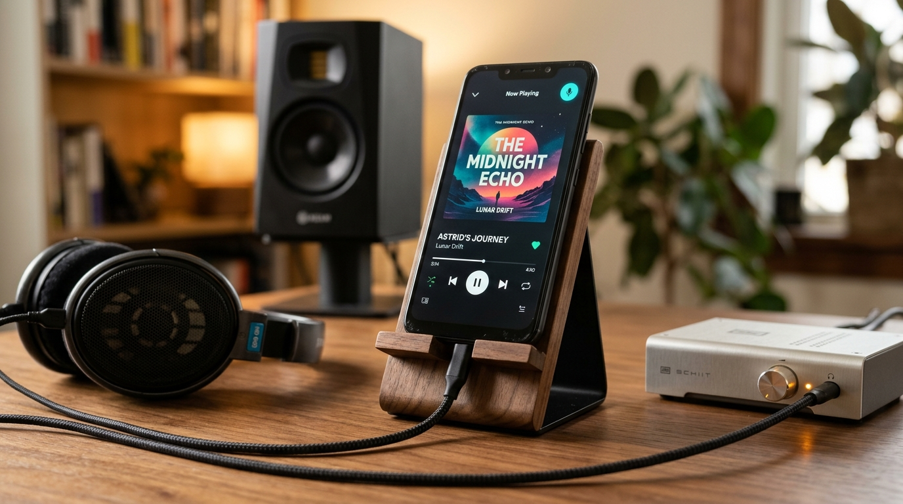
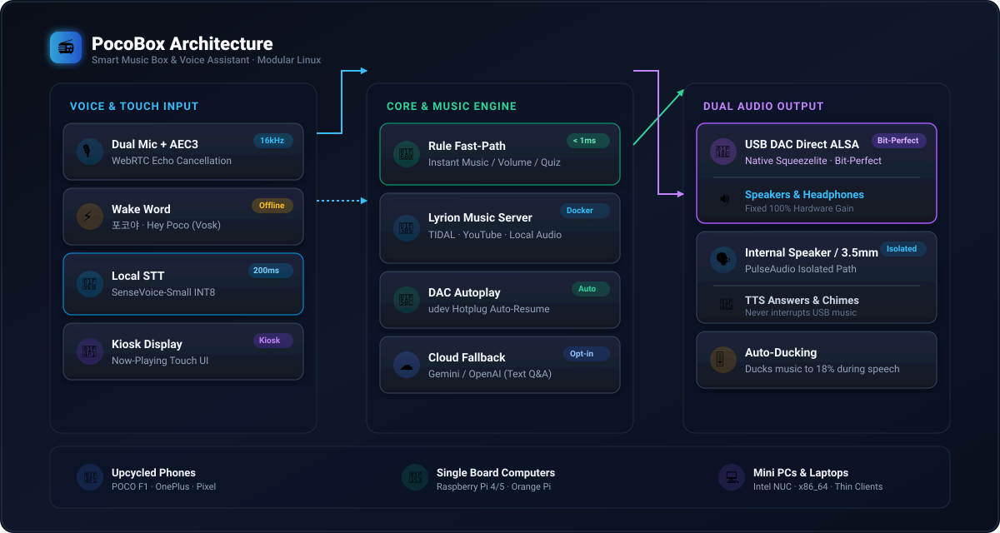

# PocoBox

<p align="center">
  
</p>

**PocoBox**는 쓰지 않는 중고 스마트폰, 싱글보드 컴퓨터(Raspberry Pi 등), 또는 저전력 미니 PC를 상시 대기형 전용 스마트 오디오 플레이어 겸 한/영 음성 어시스턴트로 업사이클링하는 오픈소스 소프트웨어 스택입니다.

**Xiaomi POCO F1 (`xiaomi-beryllium`)**을 기준 하드웨어(Reference Device)로 개발되었으나, **핵심 파이프라인 전체가 표준 리눅스(postmarketOS, Debian, Ubuntu, Raspberry Pi OS, Alpine) 기반으로 모듈화**되어 있어 하드웨어 제약 없이 손쉽게 포팅하고 확장할 수 있습니다.

- **Lyrion Music Server (LMS · TIDAL / YouTube / 로컬 음원)** 무중단 호스트 스트리밍
- **외부 USB DAC 핫플러그 감지 시 100% Bit-perfect ALSA 직결 & 자동 이어재생**
- **로컬 우선 하이브리드 음성 명령 (SenseVoice-Small INT8 STT + 규칙 Fast-Path + 클라우드 LLM 폴백)**
- **하드웨어 볼륨 및 오디오 경로 물리적 격리 (음악 재생은 USB DAC 100% 고정, 차임/TTS는 내장 스피커 분리)**
- **풀스크린 반응형 Now-Playing 키오스크 UI 및 실시간 VAD/AEC 엔지니어링 대시보드**

---

## 주요 기능 및 핵심 아키텍처 (Key Features & Highlights)

### 1. 상시 호스트 기반 Lyrion Music Server (LMS · TIDAL · YouTube)
- **호스트 네트워크 Docker 컨테이너 (`:9000`)**: SlimProto(`3483`), Web UI(`9000`), CLI(`9090`), mDNS가 브릿지 오버헤드 없이 네이티브 직결됩니다.
- **TIDAL & YouTube 완벽 지원**: TIDAL 공식 플러그인(OAuth 기기 인증), My Mix, 트랙 라디오(DSTM), K-pop/클래식 공식 뮤직비디오 스트리밍을 지원합니다.
- **네이티브 Squeezelite 플레이어**: C 소스로 직접 빌드된 경량 데몬으로 ALSA Bit-perfect 직결, DSD, SoXR VHQ 리샘플링, Opus, SSL 스트리밍을 제공합니다.

### 2. USB DAC 핫플러그 감지 & Bit-Perfect 자동 이어재생
- **Linux udev 이벤트 연동 (`pocobox-dac-autoplay`)**: 외장 USB DAC 연결 시 1초 내 ALSA 카드 ID를 감지하여 Squeezelite 출력을 `hw:CARD=<ID>,DEV=0`으로 즉각 전환합니다.
- **스마트 재생 제어**: DAC 연결 시 이전 재생 대기열을 자동으로 이어서 재생(Resume)하며, 케이블 분리 시 즉시 일시정지(Pause)하여 내장 스피커로 소리가 튀는 것을 원천 차단합니다.
- **하드웨어 믹서 고정**: DAC 하드웨어 볼륨을 100%(0.00 dB)로 고정하여 DAC 본연의 다이내믹 레인지와 비트 퍼펙트 음질을 유지합니다.

### 3. 로컬 우선 초저지연 하이브리드 음성 제어 (Local-First Voice Control)
- **오프라인 0초 호출어 감지**: WebRTC AEC3 음향 에코 캔슬러와 Vosk 초경량 문법 모델이 결합되어 음악 재생 중에도 오작동 없이 `"포코야"`, `"Hey Poco"` 호출을 정확히 포착하며, 감지 즉시 LMS 음악을 18%로 자동 감쇄(Auto-Ducking)합니다.
- **온디바이스 SenseVoice STT (~150–300ms)**: Docker 컨테이너(`pocobox-stt`)에서 구동되는 INT8 모델로 한국어/영어 자연어를 완전 오프라인으로 고속 전사하며 클라우드 API 호출 비용이 들지 않습니다.
- **초고속 서브밀리초 규칙 엔진 (<1ms)**: 곡 검색, 재생 제어, 볼륨, 한국 표준시(KST) 시간/날씨, 이중언어 영어 퀴즈 등 84개+ 실전 명령 패턴을 로컬에서 1ms 미만에 즉시 파싱 및 실행합니다.
- **선택적 클라우드/SLM 폴백**: 백과사전식 Q&A나 미등록 발화에 한해 텍스트만 Gemini 또는 OpenAI로 안전하게 에스컬레이션합니다.

### 4. 물리적 오디오 경로 격리 (Audio Path Isolation)
- **하이파이 음악 감상 보호**: 메인 음악 스트림은 외장 USB DAC로만 독점 출력됩니다.
- **안내음/TTS 격리**: 피드백 차임음, 음성 안내, 영어 퀴즈 구연동화는 헤드리스 PulseAudio를 통해 기기 내장 스피커(또는 온보드 3.5mm 단자)로만 분리 출력되어 음악 감상을 결코 방해하지 않습니다.

### 5. 풀스크린 반응형 Now-Playing 키오스크 UI & 대시보드
- **상시 전용 키오스크 (`/display`)**: 초경량 Wayland 콤포지터(`cage`) + `firefox-esr` 기반으로 잠금화면 없이 앨범 아트워크, 트랙 정보, 재생 제어, 실시간 음성 자막을 풀스크린으로 표시합니다.
- **스마트 백라이트 절전 (`pocobox-backlight`)**: 음악 정지 시 디스플레이를 자동 절전(`DISPLAY_POWER_MODE=auto`)하고, 터치 또는 재생 시 즉각 복귀합니다. 가속도계 센서(`iio-sensor-proxy`) 기반 자동 화면 회전을 지원합니다.
- **실시간 엔지니어링 대시보드 (`/dashboard`)**: 마이크 RMS 레벨, VAD 임계치, 에코 캔슬링(AEC3) 감쇄율, 적응형 발음 학습 현황을 웹에서 실시간 모니터링 및 튜닝할 수 있습니다.

### 6. 무인 24/7 상시 운영 안정화
- Wi-Fi 절전 방지(`99-pocobox-no-powersave.conf`) 및 커널 자동 슬립 방지(`99-pocobox-nosuspend.conf`).
- 스마트폰 기종의 경우 내장 배터리가 무정전 전원 장치(UPS) 역할을 수행하여 전원 케이블 분리나 이동 시에도 무중단 동작.
- `nftables` 방화벽 자동 구성 및 장애 발생 시 systemd 자동 재기동 보장.

---

## 빠른 사용

```sh
# SSH 접속
ssh pocobox

# LMS 웹 UI (Material Skin)
open http://pocobox.local:9000/material/

# 음성 명령 API 상태 확인 & 텍스트 테스트
curl -s http://pocobox.local:8765/health
ssh pocobox 'pocobox-voice say "아이유 밤편지 틀어줘"'

# 전체 테스트 셋 실행 (단위 + 84개 데이터셋)
python3 -m unittest discover -s tests -p "test_*.py" -v

# 실제 pocobox 대상 라이브 TIDAL 78개 벤치마크
python3 tests/run_voice_benchmark.py --live http://pocobox.local:8765 --live-limit 100
```

---

## 하드웨어 확장성 (Hardware Portability & Beyond POCO F1)

<p align="center">
  
</p>

PocoBox는 기준 기기인 POCO F1 외에도 표준 리눅스(`systemd` + ALSA/PulseAudio + Docker)가 지원되는 다양한 하드웨어 환경에 손쉽게 배포할 수 있습니다.

| 기기 유형 | 대표 기기 예시 | 장점 및 특징 | 오디오 / 디스플레이 구성 |
|---|---|---|---|
| **중고 스마트폰 / 태블릿 (업사이클링)** | POCO F1, OnePlus 6/6T, Pixel 3, LG G7/V35 등 (postmarketOS 메인라인 기기) | **화면 + 배터리(UPS) + 고감도 마이크 + 내장 스피커 + Wi-Fi가 일체형**으로 통합되어 추가 부품 비용 0원으로 상시 구동 가능 | 내장 마이크/스피커로 안내 및 차임 분리 + USB-C DAC 직결 시 Hi-Res Bit-perfect 출력 |
| **싱글보드 컴퓨터 (SBC)** | Raspberry Pi 4 / 5, Orange Pi 5 (RK3588), Radxa Rock | 발열 및 전력 소모가 적고 상시 켜두기 유리하며, 포트 구성이 넉넉함 | USB 마이크 / I2S 마이크 어레이(ReSpeaker 등) + USB DAC + HDMI/DSI 터치스크린 |
| **미니 PC / 구형 노트북 / 씬클라이언트** | Intel NUC, Lenovo ThinkCentre Tiny, 구형 노트북 (x86_64 / arm64) | 강력한 CPU 연산력으로 온디바이스 SLM 및 고속 STT 병렬 처리 최적 | USB DAC 직결, 노트북인 경우 내장 디스플레이·배터리·마이크 즉시 활용 |

### 타 기기 이식 시 확인 사항 (하드웨어 추상화)
1. **USB Host 모드**:
   - Raspberry Pi나 일반 미니 PC는 기본적으로 USB Host 모드로 동작하므로 **DTB 패치 없이 즉시 USB DAC를 인식**합니다.
   - 스마트폰 기종 중 메인라인 커널 기본값이 peripheral인 경우에만 Device Tree `dr_mode = "host"` 설정이 필요합니다.
2. **오디오 경로 분리 (`voice.env` & `dac-autoplay.env`)**:
   - `VOICE_SPEAKER_SINK`: 음성 차임 및 TTS를 출력할 PulseAudio 싱크 이름을 지정합니다 (미지정 시 내장 SoC/온보드 사운드카드 자동 선택, USB DAC 제외).
   - `DAC_OUTPUT_TEMPLATE`: 기본값 `hw:CARD={card_id},DEV=0`으로 모든 리눅스 표준 USB 오디오 장치에 Bit-perfect 직결됩니다.
3. **디스플레이 및 백라이트 (`display.env`)**:
   - 화면이 있는 기기는 `cage + firefox-esr` 풀스크린 키오스크로 Now-Playing 화면을 자동 표시합니다.
   - 백라이트 제어 데몬(`pocobox-backlight`)은 `/sys/class/backlight/*`를 자동 감지하며, 백라이트 인터페이스가 없는 일반 HDMI 모니터나 헤드리스 환경에서는 안전하게 no-op 처리됩니다.
4. **로컬 STT 컨테이너 (`infra/stt/`)**:
   - `sherpa-onnx` 기반 SenseVoice-Small INT8 서버는 ARM64(`aarch64`) 및 x86_64(`amd64`) 모두 멀티 아키텍처를 지원하므로 도커 환경에서 그대로 빌드 및 구동됩니다.

---

## 프로젝트 구조

```text
pocobox/
├── README.md
├── docs/
│   ├── 01-linux-installation.md       # 부트로더 언락 ~ postmarketOS 설치·네트워크 구축 기록
│   ├── 02-project-architecture.md     # LMS(TIDAL) · USB DAC 자동재생 · 하이브리드 음성명령 설계서
│   └── 03-operations-and-testing.md   # 운영 매뉴얼, API 키 설정, 테스트 셋 실행 가이드
├── infra/
│   ├── audio/                         # 헤드리스 PulseAudio systemd 서비스
│   ├── lms/                           # Lyrion Music Server Docker Compose
│   ├── squeezelite/                   # Squeezelite 네이티브 arm64 빌드/서비스
│   ├── system/                        # Wi-Fi 절전 방지, 슬립 방지, nftables 방화벽 규칙
│   ├── usb-dac/                       # USB-C Host DTB 패치/복구 스크립트, DAC 자동재생 서비스
│   └── voice/                         # 하이브리드 음성명령 서비스, env 템플릿, Phosh 앱 아이콘
├── services/
│   ├── lms_client/                    # LMS JSON-RPC + TIDAL 스마트 검색/재생 클라이언트
│   ├── usb_dac_autoplay/              # USB DAC 핫플러그 감시 및 자동 이어재생 데몬
│   └── voice_control/                 # 하이브리드 음성명령 파이프라인 (규칙/별칭/클라우드/VAD/데몬/CLI)
├── tests/
│   ├── dataset/voice_commands_ko_en.json  # 84개 한국어/영어 혼합 음성명령 테스트 데이터셋
│   ├── test_voice_intent_dataset.py       # 데이터셋 정확도·성능 회귀 테스트
│   ├── test_voice_executor_and_cloud.py   # 실행기·TIDAL 폴백·Gemini/OpenAI 모킹·VAD 테스트
│   ├── test_usb_dac_autoplay.py           # USB DAC 핫플러그·이어재생·일시정지 단위 테스트
│   ├── test_live_pocobox_e2e.py           # 실제 pocobox 대상 라이브 E2E 통합 테스트
│   ├── run_voice_benchmark.py             # 카테고리별 정확도 벤치마크 리포트
│   └── generate_audio_samples.sh          # macOS TTS 한국어/영어 WAV 픽스처 생성 및 VAD 검증
└── scripts/
    ├── deploy-phase1.sh
    └── deploy.sh                          # 전체 스택(Phase 1~4) 원클릭 배포 스크립트
```
