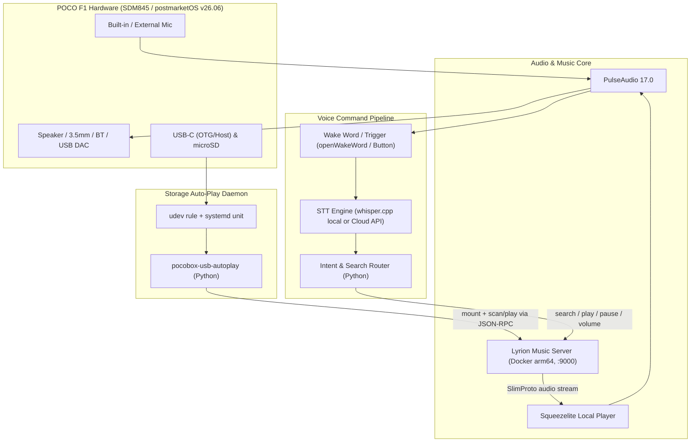

# 02. PocoBox 프로젝트 설계서 — LMS · USB 자동재생 · 음성명령 뮤직박스

## 1. 프로젝트 목표

POCO F1 (`pocobox`) 한 대로 아래 세 가지 기능을 유기적으로 통합한 리눅스 스마트 뮤직 박스를 구축합니다.

1. **Lyrion Music Server (LMS) + 로컬 플레이어(Squeezelite)**
   - 웹 UI(`:9000`)와 JSON-RPC API(`/jsonrpc.js`)를 제공하는 음악 서버 구축
   - 로컬 저장소(내부 저장소, 외부 USB, microSD) 및 네트워크 음원 통합 관리 및 재생
   - 기기 자체 스피커 / 3.5mm 이어폰 단자 / Bluetooth / (지원 시) USB DAC 출력
2. **외부 USB 연결 시 자동 음악 재생**
   - USB 메모리/외장 저장장치를 연결하면 자동으로 마운트하고 음원 스캔/재생을 트리거
   - 분리 시 안전한 언마운트 및 재생 정리
3. **음성 명령 기반 음악 검색 및 재생**
   - 한국어/영어 혼합 가수명·곡명·장르·제어 명령("OO 노래 틀어줘", "다음 곡", "멈춰", "볼륨 올려줘") 인식
   - LMS JSON-RPC API로 검색·대기열 구성·재생 제어 및 상태 피드백

---

## 2. 시스템 아키텍처

---

## 3. 컴포넌트별 기술 검토 및 핵심 확인 사항

### 3.1 Lyrion Music Server (LMS) + Squeezelite
- **LMS 실행 방식**: Docker (`lmscommunity/lyrionmusicserver:stable`, `linux/arm64` 공식 지원)
  - Alpine/musl 환경에서 Perl CPAN 바이너리 의존성 충돌을 피하고 업그레이드/백업을 단순화할 수 있습니다.
  - 볼륨 구성:
    - `/srv/pocobox/lms/config` → `/config`
    - `/srv/pocobox/music` (내부 음악 + `/mnt/usb` 바인드 마운트) → `/music`
    - `/srv/pocobox/playlists` → `/playlist`
- **로컬 플레이어**: **Squeezelite**
  - Alpine `apk`에 기본 패키지가 없으므로 Docker 컨테이너(PulseAudio 소켓 마운트) 또는 `arm64` 네이티브 빌드(ALSA/PulseAudio 출력)로 실행합니다.
  - PulseAudio 17.0과 연동하여 Phosh 볼륨 조절 및 3.5mm/블루투스 자동 라우팅과 호환되도록 구성합니다.

### 3.2 외부 USB 연결 시 자동 음악 재생 (⚠️ 하드웨어 사전 검증 필요)
실제 기기 커널 점검에서 다음 사실을 확인했습니다:
- 커널 모듈 `CONFIG_USB_STORAGE=m`, `CONFIG_SND_USB_AUDIO=m`, `CONFIG_USB_DWC3=y`는 **이미 빌드되어 있음**.
- 그러나 현재 Device Tree의 USB-C 컨트롤러가 **`dr_mode = "peripheral"`**로 고정되어 있습니다 (`postmarketOS` POCO F1 위키 기준 `USB OTG`는 기본 비활성).

따라서 Phase 2 진입 시 아래 순서를 밟습니다:
1. **USB Host/OTG 활성화 테스트**
   - Device Tree(`sdm845-xiaomi-beryllium-ebbg.dtb`)의 `usb@a600000` `dr_mode`를 `host` 또는 `otg`로 변경하거나 커스텀 부트 이미지로 테스트
   - POCO F1 메인라인 `pmi8998`의 VBUS 5V 부스트 미지원 가능성을 고려해 **외부 전원 공급형 USB-C PD 허브(또는 전원 공급 OTG Y-케이블)**를 사용하면 안정적인 USB 메모리/DAC 인식 및 충전 동시 운용 가능
   - Wi-Fi SSH(`ssh pocobox`)가 이미 확보되어 있으므로 USB 가젯 네트워크 없이도 기기 관리 가능
2. **microSD 슬롯 동시 지원**
   - POCO F1의 microSD 슬롯은 메인라인에서 즉시 동작하므로, 동일한 자동 마운트·자동 재생 파이프라인(`pocobox-media-autoplay`)이 USB 저장소와 microSD 모두를 투명하게 처리하도록 설계합니다.
3. **자동 재생 동작 흐름**
   - `udev`가 블록 장치(`/dev/sd*`, `/dev/mmcblk*`) 연결 감지 → `systemd` 서비스 실행
   - 읽기 전용 또는 안전 옵션으로 `/mnt/external/<label>` 마운트 (`exfat`, `vfat`, `ntfs3`, `ext4` 지원)
   - 오디오 파일(`.mp3`, `.flac`, `.m4a`, `.wav`, `.ogg`, `.opus`) 탐지 시:
     - 옵션 1: LMS에 해당 폴더를 재생목록(`playlist play` 또는 `rescan` 후 재생)으로 즉시 전송
     - 옵션 2: 재생 시작 전/후 짧은 안내음 출력 및 기존 재생 상태 기억

### 3.3 음성 명령으로 음악 검색 및 재생
- **마이크 입력**: 내장 마이크(`alsa_input.platform-sound.HiFi__Mic1__source`) 우선 테스트 (필요 시 3.5mm/Bluetooth/USB 마이크 전환 가능)
- **설계 선택지 (구현 전 확정 필요)**:

| 항목 | 옵션 A: 완전 로컬 (오프라인) | 옵션 B: 하이브리드 (로컬 Wake Word + 클라우드 STT/LLM) |
| --- | --- | --- |
| **호출 방식** | `openWakeWord` (상시 대기) 또는 물리 볼륨키/화면 버튼 | 동일 |
| **음성 인식(STT)** | `whisper.cpp` (ARM64 NEON, `small`/`base` Q5) | OpenAI Whisper / Gemini Audio API |
| **한국어+영어 혼합 인식률** | 보통~좋음 (가수명·외래어 오인식 간헐 발생) | **매우 높음** (한국어+영어 곡명/가수명/자연어 의도 파악 우수) |
| **응답 속도 (SDM845)** | 약 2~5초 (모델 크기 비례) | 약 0.8~1.5초 |
| **네트워크 의존성** | 없음 (완전 오프라인) | Wi-Fi 필요 (오프라인 시 로컬 폴백 가능) |

- **지원할 기본 음성 명령 예시**:
  - 재생/검색: *"아이유 노래 틀어줘"*, *"잔나비 주저하는 연인들을 위해 재생해줘"*, *"재즈 틀어줘"*, *"USB 음악 틀어줘"*
  - 재생 제어: *"멈춰 / 일시정지"*, *"계속 재생"*, *"다음 곡"*, *"이전 곡"*, *"볼륨 올려줘 / 내려줘 / 50으로 해줘"*

---

## 4. 단계별 실행 로드맵

### Phase 1 — LMS + Squeezelite 기본 오디오 스택 (우선 착수)
- [ ] `pocobox`에 Docker 설치 및 `systemd` 활성화 확인
- [ ] `infra/lms/docker-compose.yml` 작성 및 LMS (`:9000`) 구동
- [ ] Squeezelite 설치 및 PulseAudio 출력 연동 (스피커/이어폰 테스트 음원 재생 검증)
- [ ] LMS JSON-RPC 클라이언트(`services/lms_client/`) 구현 및 CLI 테스트

### Phase 2 — 외부 USB / microSD 자동 마운트 & 자동 재생
- [ ] POCO F1 USB-C Host/OTG 모드(`dr_mode` DTB 테스트 + 전원 공급 허브 유무 확인) 검증
- [ ] `udev` 룰 + `systemd` 마운트 & `services/usb_autoplay/` 데몬 구현
- [ ] USB/SD 삽입 → 자동 마운트 → LMS 즉시 재생, 제거 → 안전한 정지/언마운트 검증

### Phase 3 — 음성 명령 검색 & 재생 파이프라인
- [ ] POCO F1 내장 마이크 녹음 품질 및 감도 테스트 (`arecord`/`parecord`)
- [ ] 확정된 트리거(Wake Word / 버튼) + STT + Intent Parser 구현 (`services/voice_control/`)
- [ ] LMS 라이브러리 검색(아티스트/앨범/곡명 퍼지 매칭) + 재생 제어 연동 및 E2E 테스트

### Phase 4 — 운영 안정화
- [ ] 모든 서비스 `systemd` 자동 시작 및 장애 재시작 설정
- [ ] 기본 비밀번호 변경, SSH 키 전용 전환 등 보안 강화
- [ ] 배포 자동화 스크립트 (`scripts/deploy.sh` — Mac에서 `pocobox`로 원클릭 배포)
