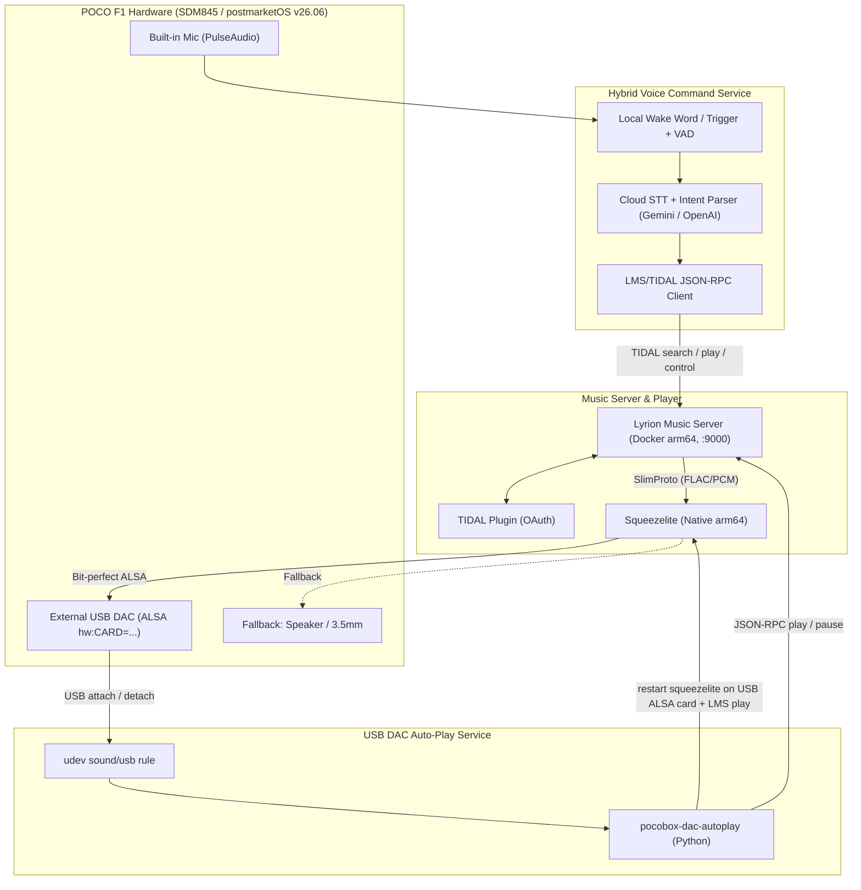
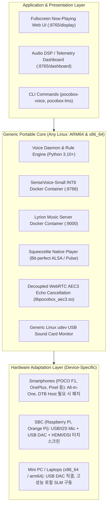

# 02. PocoBox 프로젝트 설계서 — LMS(TIDAL) · USB DAC 자동재생 · 하이브리드 음성명령

## 1. 확정 요구사항

1. **Lyrion Music Server (LMS) + TIDAL 스트리밍 중심**
   - `http://pocobox.local:9000` 웹 UI 및 JSON-RPC API(`/jsonrpc.js`) 운영
   - 공식 **TIDAL 플러그인** 연동으로 TIDAL 음원 검색·재생·플레이리스트/마이믹스 제어
2. **외부 USB DAC 연결 시 자동 출력 전환 및 자동 음악 재생**
   - USB 메모리(외장 저장소)는 사용하지 않음
   - **USB DAC**를 POCO F1에 연결하면 자동으로 감지 → Squeezelite를 해당 USB DAC(ALSA bit-perfect 직결)으로 전환/기동 → **LMS(TIDAL) 자동 재생 시작**
   - USB DAC 분리 시 자동으로 일시정지하고 안전하게 정리(필요 시 내장 스피커/3.5mm로 대기 전환)
3. **하이브리드 음성 명령 (빠른 응답 + 높은 한국어/영어 혼합 인식률)**
   - **로컬 트리거**: 상시 대기 Wake Word(`openWakeWord`) 또는 물리/화면 버튼 트리거 + VAD
   - **클라우드 STT + Intent 해석**: Gemini API 또는 OpenAI Whisper/LLM API로 약 1초 내외 빠른 응답과 한국어+영어 혼합 아티스트/곡명 높은 인식률 확보
   - **LMS JSON-RPC 연동**: TIDAL 카탈로그 검색, 재생/일시정지/다음곡/볼륨 조절 즉시 수행

---

## 2. 시스템 아키텍처



---

## 3. 컴포넌트별 상세 설계

### 3.1 Lyrion Music Server (LMS) + TIDAL + Squeezelite (Phase 1)
- **LMS**: `lmscommunity/lyrionmusicserver:stable` (`linux/arm64`, `network_mode: host`)
  - 호스트 네트워크 사용 이유: SlimProto(`3483/tcp,udp`), Web UI(`9000/tcp`), CLI(`9090/tcp`), mDNS/디스커버리가 컨테이너 NAT 없이 즉시 동작
  - 데이터 영속화: `/srv/pocobox/lms/{config,music,playlist}`
  - **TIDAL 연동**: LMS 웹 UI(`http://pocobox.local:9000`) → Settings → Manage Plugins → **TIDAL** 활성화 후 OAuth 기기 인증
- **Squeezelite (네이티브 arm64 빌드)**:
  - Alpine Linux(`pocobox`)에서 C 소스로 직접 컴파일 (`/usr/local/bin/squeezelite`)
  - 장점:
    - USB DAC 연결 시 ALSA `hw:CARD=<dac>` 직접 점유(**bit-perfect**, 리샘플링 없음, DSD/고해상도 지원)
    - 메모리 사용량 ~10MB 미만, `systemd`로 즉각 재시작/장치 전환 가능
    - 환경변수 파일(`/etc/pocobox/squeezelite.env`)만 갱신하고 재시작하면 출력 장치(내장 오디오 ↔ USB DAC)를 1초 내 전환

### 3.2 USB-C Host/OTG 활성화 & USB DAC 자동 재생 (Phase 2)
실제 기기 커널 점검 결과:
- `CONFIG_SND_USB_AUDIO=m`, `CONFIG_USB_DWC3=y`, `CONFIG_TYPEC=y`, `CONFIG_USB_ROLE_SWITCH=y` 모두 **커널에 이미 포함됨**.
- 단, 현재 `/boot/sdm845-xiaomi-beryllium-ebbg.dtb`의 `usb@a600000` 노드에서 `dr_mode = "peripheral"`로 설정되어 있음.

Phase 2 구현 절차:
1. **원본 `/boot/boot.img` 백업** (기기 및 Mac 양쪽에 보관 → 언제든 `fastboot flash boot`로 10초 복구 가능)
2. **DTB `dr_mode` 변경 검증** (`peripheral` → `host` 또는 `otg`) 및 부트 이미지 반영
   - POCO F1 메인라인 `pmi8998`의 VBUS 5V 공급 여부에 따라 직결 OTG 또는 **전원 공급형 USB-C 허브/Y케이블** 환경에서 `aplay -l` USB DAC 인식 확인
   - Wi-Fi SSH(`ssh pocobox`)가 이미 확보되어 있어 USB 가젯 네트워크 없이도 안전하게 관리 가능
3. **USB DAC 핫플러그 자동재생 데몬 (`pocobox-dac-autoplay`)**:
   - `udev` 룰이 `SUBSYSTEM=="sound", ACTION=="add|remove"` (USB 오디오 카드, `card != 0`) 이벤트 감지
   - **연결(add) 시**:
     1. 새로 붙은 USB DAC ALSA 카드 이름(`aplay -l` / `/proc/asound/cards`) 자동 식별
     2. `/etc/pocobox/squeezelite.env`의 출력 디바이스를 `hw:CARD=<DAC_NAME>`으로 갱신 후 `squeezelite.service` 재시작
     3. LMS JSON-RPC로 `pocobox` 플레이어 접속 확인 후 자동 재생 시작 (마지막 재생 곡/큐가 있으면 이어서 `play`, 큐가 비어 있으면 설정된 기본 TIDAL 플레이리스트/마이믹스 자동 재생!)
   - **분리(remove) 시**:
     1. LMS JSON-RPC로 즉시 `pause` 전송 (내장 스피커로 갑자기 소리 튀는 것 방지)
     2. Squeezelite를 안전하게 정지하거나 내장 오디오 대기 상태로 전환

### 3.3 하이브리드 음성 명령 파이프라인 (Phase 3)
- **오디오 캡처**: POCO F1 내장 마이크(`alsa_input.platform-sound.HiFi__Mic1__source`) + WebRTC VAD / 침묵 감지로 발화 구간만 정확히 잘라냄
- **호출 방식 (2가지 병행 지원)**:
  - **상시 호출어 (Wake Word)**: `openWakeWord` (CPU 점유율 낮음, 로컬 오프라인 동작)
  - **즉시 호출 버튼**: POCO F1 화면의 Phosh 버튼 또는 물리 볼륨키(길게 누르기 등)
- **클라우드 STT + Intent 해석**:
  - 녹음된 짧은 오디오(보통 2~5초)를 **Gemini Audio API** (또는 OpenAI Whisper + 경량 LLM)로 전송
  - 단일 호출로 **음성 → 구조화된 JSON 명령** 반환:
    ```json
    {"action": "play_search", "query": "아이유 밤편지", "type": "track", "source": "tidal"}
    ```
  - 지원 액션: `play_search`(곡/아티스트/앨범/플레이리스트 검색 후 재생), `pause`, `resume`, `next`, `previous`, `volume_up`, `volume_down`, `volume_set`, `what_is_playing`
- **LMS JSON-RPC 실행 & 피드백**:
  - LMS `tidal` 플러그인 검색 메뉴(`["tidal", "items", 0, 10, "search:..."]`) 및 로컬 라이브러리 통합 검색
  - 명령 인식 시작/완료 시 짧은 비프음(또는 가벼운 TTS 안내) 출력

---

## 4. 단계별 마일스톤

### Phase 1 — LMS + Squeezelite 기반 구축 (진행 중)
- [ ] `pocobox`에 Docker 설치 및 `docker.service` 활성화
- [ ] `infra/lms/docker-compose.yml` 작성 및 LMS (`:9000`) 구동
- [ ] Squeezelite 네이티브 arm64 빌드 및 `systemd` 서비스 구성 (우선 내장 스피커/3.5mm로 LMS 재생 검증)
- [ ] `services/lms_client/` JSON-RPC CLI 작성 (플레이어 조회, 재생/정지/볼륨, TIDAL 검색 테스트)
- [ ] 사용자 LMS 웹 UI(`http://pocobox.local:9000`)에서 TIDAL 플러그인 로그인 완료

### Phase 2 — USB-C Host/OTG + USB DAC 자동 재생
- [ ] 원본 `boot.img` 백업 + DTB `dr_mode` Host/OTG 전환 및 USB DAC ALSA 인식 검증
- [ ] `udev` + `pocobox-dac-autoplay` 구현 (USB DAC 연결 → bit-perfect 전환 → 자동 재생 / 분리 → 자동 일시정지)

### Phase 3 — 하이브리드 음성 명령
- [ ] POCO F1 내장 마이크 녹음 품질 및 감도 검증
- [ ] `services/voice_control/` 구현 (호출어/버튼 + VAD + 클라우드 STT/Intent + LMS TIDAL 검색/재생)
- [ ] `systemd` 상시 서비스 등록 및 실사용 튜닝

### Phase 4 — 마무리 및 운영 안정화
- [ ] 기본 비밀번호 변경, SSH 키 전용 보안 설정
- [ ] 자동 배포 스크립트 및 전체 운영 매뉴얼 정리

---

## 5. 하드웨어 이식성 및 범용 리눅스 확장 설계 (Hardware Portability)

PocoBox 아키텍처는 기준 기기인 POCO F1(Snapdragon 845)에 종속되지 않도록 **범용 코어 계층(Generic Core)**과 **하드웨어 적응 계층(HAL)**을 명확히 분리하여 설계되었습니다.

### 5.1 계층 구조 (Layered Architecture)



### 5.2 기기별 구성 차이 및 이식 가이드

| 구성 요소 | 스마트폰 업사이클링 (POCO F1 등) | 싱글보드 컴퓨터 (Raspberry Pi 4/5 등) | 미니 PC / 노트북 (x86_64) |
|---|---|---|---|
| **OS 환경** | postmarketOS / Alpine (`musl`, systemd) | Raspberry Pi OS / Debian / Ubuntu | Debian / Ubuntu / Arch Linux |
| **USB Host** | 기종에 따라 DTB `dr_mode="host"` 설정 필요 | 기본 제공 (패치 불필요) | 기본 제공 (패치 불필요) |
| **마이크 입력** | 스마트폰 내장 마이크 (PulseAudio source) | USB 마이크 / I2S 마이크 모듈 (ReSpeaker 등) | USB 마이크 / 노트북 내장 마이크 |
| **안내음/TTS 출력** | 스마트폰 내장 스피커 (PulseAudio sink 분리) | 3.5mm 오디오 / 보조 스피커 / 모니터 스피커 | 메인보드 3.5mm / 내장 스피커 |
| **Hi-Res 음악 출력** | USB-C DAC 직결 (`hw:CARD=...,DEV=0`) | USB DAC 직결 (`hw:CARD=...,DEV=0`) | USB DAC 직결 (`hw:CARD=...,DEV=0`) |
| **화면/터치** | 내장 LCD 터치스크린 (`cage + firefox-esr`) | 공식 7인치 터치스크린 / HDMI 디스플레이 | 내장 화면 / 외부 모니터 / 헤드리스 모드 |
| **백라이트 제어** | `/sys/class/backlight/*` 자동 감지 | `rpi_backlight` 또는 DPMS | `intel_backlight` 또는 DPMS (헤드리스 시 no-op) |
